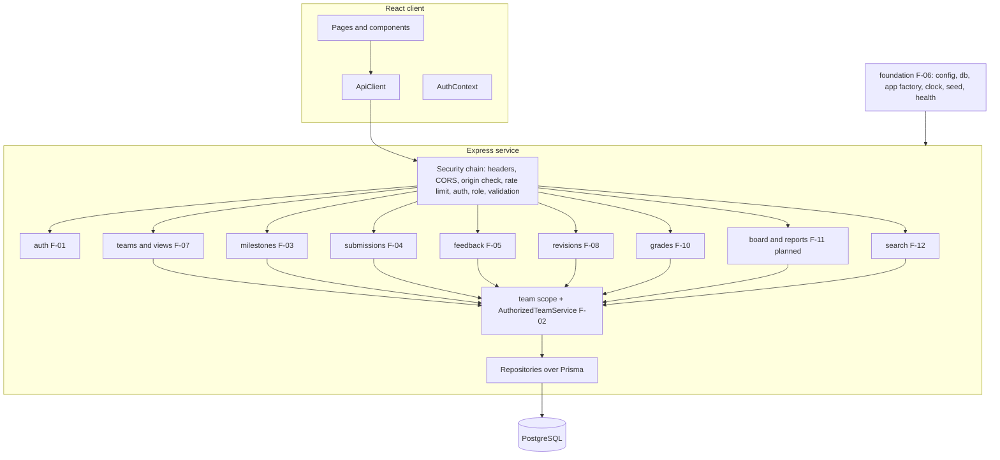

# CPMS Product Architecture Plan (all features)

**Version:** 1.2 (Sprint 2 and Sprint 3 design, 2026-11-25)
**Related:** [System SDS](system-sds.md) · [Sprint 1 pattern plan](sprints/sprint-1/architecture.md) · [Security test plan](security-test-plan.md) · [Features](features.md)

## Version history

| Version | Date | Change |
|---|---|---|
| 1.2 | 2026-11-25 | F-08 to F-12 updated from proposed directions to the proposed design (approval pending): versioned `Submission` rows, `closedAt`, a separate `Grade` table (replaces the nullable `Feedback.grade` idea), scoped search. See the [change register](sprints/sprint-2/change-register.md). |
| 1.1 | 2026-11-07 | Status updated after Sprint 1 implementation; no requirement, rule or acceptance-criteria change. |
| 1.0 | 2026-11-06 | Reworked for Theme 6 (F-01 to F-12, X-01). |
| 0.1 | 2026-11-06 | Proposal-domain draft, superseded. |

Sprint 1 (F-01 to F-07) is implemented and is the authorized baseline. F-08 to F-12 are proposed (not yet approved) in the [SRS](srs.md); their contracts are in `sprints/sprint-2/` and `sprints/sprint-3/`. F-11 is contract only in Deliverable 2.

## 1. Principles

- One modular monolith: a React client and one Express service over one PostgreSQL database.
- Feature modules own their routes, service, repository and tests. Cross-module calls go through a module's service, never its repository.
- Identity, role and team scope come only from the server session. Every module sits behind the same security chain.
- Business rules live in pure policies and are unit-testable without Express or Prisma.
- Migrations are additive; later sprints add tables and endpoints without changing Sprint 1 contracts.

## 2. Module map

## 3. Per-feature architecture

| Feature | Module | Patterns | Data | API | Key security controls | Extension points |
|---|---|---|---|---|---|---|
| F-06 Foundation | `platform/` | Factory, Clock, test builders | All Sprint 1 tables | health, ready | Zod-validated env, no secrets in Git, seed never prints passwords | New modules mount in `createApp` |
| F-01 Auth | `auth/` | Facade, Factory, Chain | `Session` | login, logout, me | bcrypt, generic 401, dummy compare, session rotation, throttle | MFA or SSO behind `AuthService` |
| F-02 Access | `security/` | Proxy, Chain, Strategy, Factory (`AppError`) | none | none | Role and team scope, uniform 404, origin check, DTO whitelist | New role adds a scope |
| F-07 Views | `teams/` | Facade, Strategy | read only | `GET /api/teams`, `/teams/:id`, `/milestones/:id` | DB-level scoping | Filters and paging for F-12 |
| F-03 Milestone | `milestones/` | Facade, Policy | `Milestone` | `POST /api/teams/:id/milestones` | Supervisor scope, strict schema, future date | Edit and close in F-09 |
| F-04 Submission | `submissions/` | Facade, Policy, Proxy | `Submission` | `POST /api/milestones/:id/submission` | Membership, unique index, link scheme allow-list, deadline | Revisions in F-08 |
| F-05 Feedback | `feedback/` | Facade, Policy | `Feedback` | `POST /api/submissions/:id/feedback` | Supervisor scope, unique index, comment limits | Grades in F-10 |
| F-08 Revisions | `submissions/` | Policy, row lock | `Submission` rows versioned by `revisionNo` (1 to 5) | `POST /api/milestones/:id/revisions`; history in `GET /api/milestones/:id` | Same scope and BOLA tests; history immutable; unique index and CHECK; milestone row lock | Revision limit per milestone |
| F-09 Milestone mgmt | `milestones/`, `domain/closed.ts` | Facade, Policy, shared guard | `Milestone.closedAt` (status stays computed) | `PATCH /api/milestones/:id`, `POST .../close` | Supervisor scope; conditional writes; `assertMilestoneOpen` | Bulk deadlines |
| F-10 Grades | `grades/` | Policy | `Grade` table | `POST /api/submissions/:id/grade` | Supervisor scope; feedback first; current revision only; unique index and CHECK | Rubrics |
| F-11 Board and reports (planned, contract only) | `reports/` | Facade | read only aggregates | `GET /api/progress` | Scope applied before aggregation | Export |
| F-12 Search | `search/` | Policy, Builder | none (read queries, 1000-row scan cap) | `GET /api/search?q=&status=&teamId=&page=&limit=` | Strict params, scope in every query, uniform 404 for foreign `teamId`, page cap | Database-side status filter, full-text index |
| X-01 Deployment (Lab 5) | Docker, CI, Cloud Run, Cloud SQL, Secret Manager | none | none | health, ready | Secret Manager, `Secure` cookie, HTTPS, audit in CI | Staging environment |

Patterns skipped in Sprint 1 and still not needed: State in F-08 (revision number is derived, not a state machine), Observer in F-11, Iterator in F-12 (page and limit are enough at course scale).

## 4. Security chain and layers

| Layer | Controls | Verified by |
|---|---|---|
| Edge | HTTPS in production, security headers, no `X-Powered-By`, strict CORS, body size cap, JSON-only | SEC-17, SEC-18 |
| Abuse control | Global and login rate limits | SEC-08, SEC-16 |
| Request integrity | Origin check on state-changing methods, `SameSite=Lax` cookie | SEC-03 |
| Authentication | Opaque session ID, expiry, revocation, rotation on login | SEC-07 to SEC-10, SEC-15 |
| Authorization | Role guard, team scope in the query, proxy check | SEC-05, SEC-06 |
| Input | Zod strict schemas, UUID params, URL scheme allow-list, parameterized Prisma queries | SEC-02, SEC-11 to SEC-13 |
| Output | Field whitelist DTOs, JSON escaping, UI renders text, safe errors | SEC-01, SEC-14 |
| Supply chain and secrets | `npm audit`, env-only secrets | SEC-19, SEC-20 |

## 5. Data model evolution (proposed 2026-11-25, approval pending)

One Sprint 2 foundation migration: `Submission.revisionNo` with CHECK 1 to 5 and a unique index on (`milestoneId`, `revisionNo`) in place of the unique index on `milestoneId`; `Milestone.closedAt`; a new `Grade` table with CHECK 0 to 100. Feedback is not changed. The unique-index swap is not purely additive: code from before Sprint 2 cannot run on the new schema, so rollback to a pre-Sprint 2 release needs a database restore (change register RISK-01). F-12 adds no index.

## 6. Deployment architecture (Lab 5)

One container: Express serves the built client and the API. Cloud Run runs it, Cloud SQL holds PostgreSQL, Secret Manager supplies `DATABASE_URL`, `SESSION_SECRET`, `ALLOWED_ORIGIN` and seed passwords. CI runs build, tests, security tests and `npm audit` on PRs and blocks failures; a pipeline deploys accepted releases from `main`. Data survives restart because it lives in Cloud SQL. This plan runs no cloud command.

## 7. Open decisions

1. Instructor or TA confirmation of SRS decisions D-05 to D-08, D-10 to D-13 and D-16 to D-23 (revision limit, grade scale and visibility, close policy), and Drarun's confirmation of D-16 to D-23.
2. Whether F-11 is built before 13 December (see the Sprint 3 remaining-work plan).
