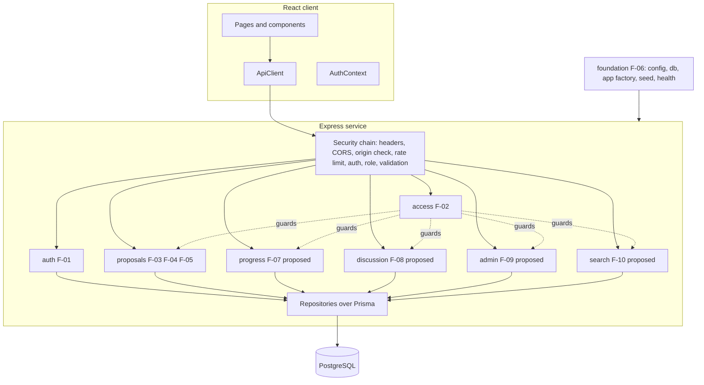
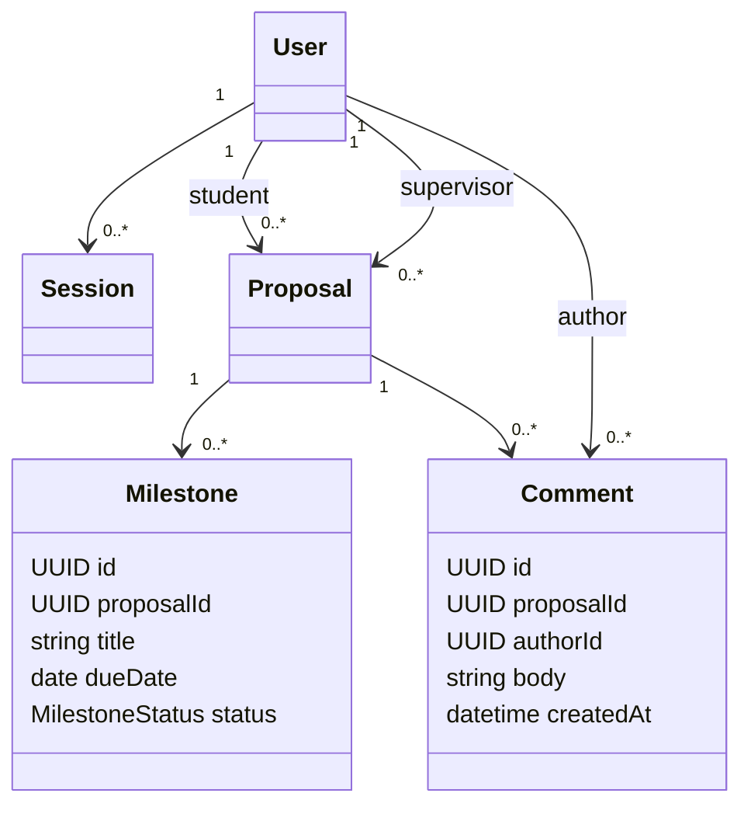

# CPMS Product Architecture Plan (all features)

**Version:** 0.1 (draft for review)
**Related:** [System SDS](system-sds.md) · [Sprint 1 pattern plan](sprints/sprint-1/architecture.md) · [Security test plan](security-test-plan.md) · [Features](features.md)

Plan only. No code exists. Sprint 1 (F-01 to F-06) is the authorized baseline. F-07 to F-10 are proposed in the [SRS](srs.md); their architecture here is a direction, not a contract, and each needs sprint authorization before detailed specification.

## 1. Principles

- One modular monolith: a React client and a single Express service over one PostgreSQL database. No microservices.
- Feature modules own their routes, service, repository and tests. Cross-module calls go through the module's service, never its repository.
- Identity and role come only from the server session. Every module sits behind the same security chain (section 4).
- Rules live in the domain layer and are unit-testable without Express or Prisma.
- Migrations are additive; later sprints add tables and endpoints without changing Sprint 1 contracts.

## 2. Module map



Backend layout, extending the [Sprint 1 layout](sprints/sprint-1/architecture.md):

```text
server/src/
  platform/   config db app errors logger          (F-06)
  security/   headers cors originCheck rateLimit requireAuth requireRole scope authorized*   (F-01, F-02)
  modules/
    auth/        service, routes, sessionRepo
    proposals/   domain/state, submissionService, reviewService, viewService, routes, repo
    progress/    (proposed F-07)
    discussion/  (proposed F-08)
    admin/       (proposed F-09)
    search/      (proposed F-10)
```

## 3. Per-feature architecture

| Feature | Module and layers | Patterns | Data | API | Key security controls | Extension points |
|---|---|---|---|---|---|---|
| F-06 Foundation | `platform/`, seed, test harness | Factory (`createApp`), test builders | `User`, `Session`, `Proposal`, enums, indexes | `GET /api/health`, `/api/ready` | Zod-validated env, no secrets in Git, strict seed (no password output) | New modules mount in `createApp` |
| F-01 Authentication | `modules/auth`: routes, `AuthService`, `sessionRepo` | Facade, Factory (session, cookie), Chain | `Session` | login, logout, me | bcrypt, generic 401, constant-time unknown-user path, session rotation on login, login rate limit | Add MFA or SSO behind `AuthService` |
| F-02 Access | `security/`: middleware, `AuthorizedProposalService`, scopes | Proxy, Chain, Strategy, Factory (`AppError`) | none | none | Role and ownership checks, uniform denial, safe error envelope | New roles add a scope and a role guard |
| F-03 Submit | `modules/proposals`: `SubmissionService`, `Proposal.create` | Facade, Factory, State (initial) | `Proposal` | `POST /api/proposals`, `GET /api/supervisors` | Strict schema (no mass assignment), session-derived student, transaction plus partial unique index | More fields or attachments via new columns |
| F-04 Review | `ReviewService`, state objects, policies | State, Facade | `Proposal` updates | `POST /api/proposals/:id/review` | Row locks, assignment and state checks, comment validation | New states or policies without touching routes |
| F-05 Views | `ViewService`, scope strategies | Facade, Strategy, Proxy | read only | `GET /api/proposals`, `GET /api/proposals/:id` | DB-level scoping, response field whitelist | Pagination and filters (F-10) |
| F-07 Milestones (proposed) | `modules/progress` | State (milestone status), Facade, Proxy | `Milestone`: id, proposalId, title, dueDate, status, createdBy | `GET/POST /api/proposals/:id/milestones`, `PATCH .../milestones/:mid` | Only proposal participants, only for `APPROVED` proposals, same BOLA tests | Notifications via event bus |
| F-08 Discussion (proposed) | `modules/discussion` | Facade, Proxy, Observer (event bus, now justified) | `Comment`: id, proposalId, authorId, body, createdAt | `GET/POST /api/proposals/:id/comments` | Body length cap, output escaping (stored XSS tests), participants only | Notify subscribers on new comment |
| F-09 Admin (proposed, needs role decision) | `modules/admin` | Strategy (`AdminScope`), Proxy | `User.role` gains `ADMIN` if approved | `GET /api/admin/users`, `PATCH /api/admin/proposals/:id/supervisor` | Admin-only guard, audit trail, no self-demotion, all actions logged | Reassignment rules via policies |
| F-10 Search (proposed) | `modules/search` | Strategy (scope), Builder (query), Iterator (cursor paging) | indexes on status, supervisor, title | `GET /api/proposals?status=&q=&cursor=` | Query params validated and parameterized, scope applied before filter, page size cap | Full-text index later |
| X-01 Deployment (Lab 5) | Docker image, CI, Cloud Run, Cloud SQL, Secret Manager | none | none | health, ready | Secrets from Secret Manager, `Secure` cookie, HTTPS only, dependency audit in CI | Staging and prod environments |

Patterns skipped in Sprint 1 (Observer, Iterator) become justified in F-08 and F-10 and are added then, not earlier.

## 4. Security chain and layers

Every request passes these layers in order. Each later layer assumes the earlier ones may have been bypassed by a bug.

| Layer | Controls | Verified by |
|---|---|---|
| Edge | HTTPS in production, security headers, no `X-Powered-By`, strict CORS (same origin), body size cap, JSON-only content type | SEC-17, SEC-18 |
| Abuse control | Global and login rate limits, failed-login backoff | SEC-08, SEC-16 |
| Request integrity | Origin check on state-changing methods, `SameSite=Lax` cookie | SEC-03 |
| Authentication | Opaque session ID, expiry, revocation, rotation on login | SEC-07 to SEC-11 |
| Authorization | Role guard, ownership or assignment check via proxy, DB-level scope | SEC-05, SEC-06 |
| Input | Zod strict schemas, UUID params, parameterized Prisma queries | SEC-02, SEC-12 to SEC-14 |
| Output | Field whitelist DTOs, JSON escaping, UI renders text, safe errors | SEC-01, SEC-15, TEST-33 |
| Supply chain and secrets | `npm audit`, env-only secrets | SEC-19, SEC-20 |

## 5. Data model evolution (proposed)



Milestone and Comment are proposed entities; they require F-07 and F-08 approval. Sprint 1 tables are unchanged.

## 6. Deployment architecture (Lab 5)

One container: Express serves the built client and the API. Cloud Run runs it, Cloud SQL holds PostgreSQL over a private connection, Secret Manager supplies `DATABASE_URL`, `SESSION_SECRET` and seed passwords as environment variables. CI runs build, tests, security tests and `npm audit`, then deploys. This plan runs no cloud command.

## 7. Open decisions

1. Whether F-09 introduces an admin role.

Closed 2026-11-06: uniform 404 for missing and unauthorized proposal IDs (SRS D-05); security NFR-07 to NFR-12 approved for Sprint 1.

## Version history

| Version | Date | Change |
|---|---|---|
| 0.1 | 2026-11-06 | Product-level architecture for F-01 to F-10 and X-01, security layers, data evolution. |
