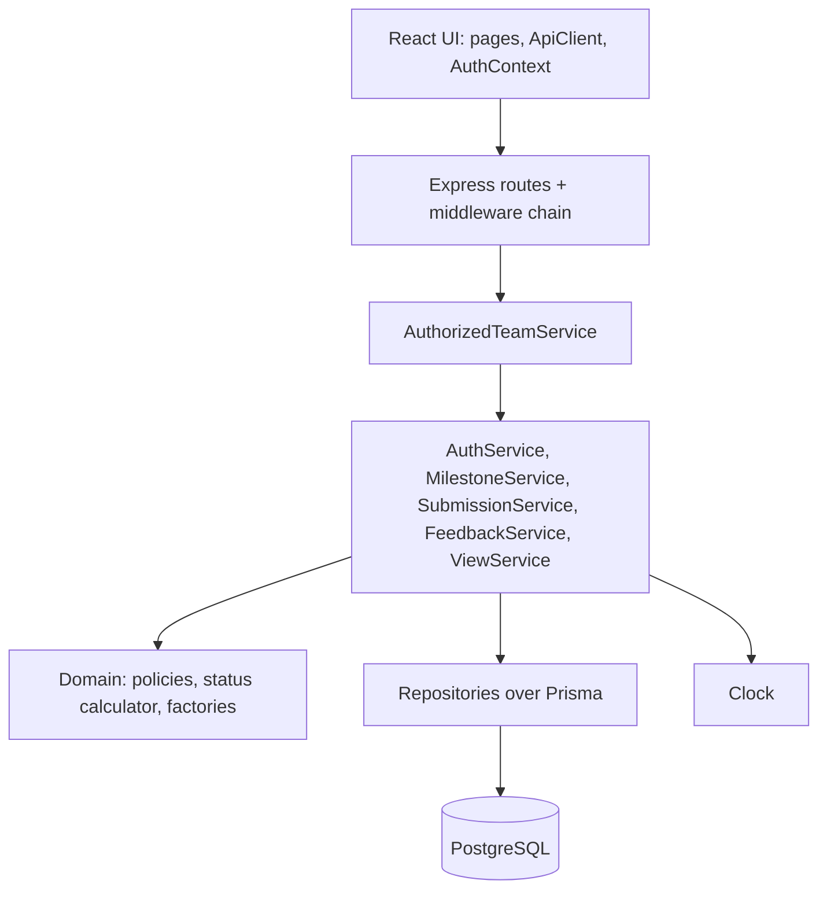

# CPMS Sprint 1 Software Architecture and Design Patterns

**Version:** 1.1 (Sprint 1 baseline)
**Related:** [System SDS](../../system-sds.md) · [Product architecture plan](../../architecture.md) · [Sprint 1 plan](plan.md) · feature contracts `F-01` to `F-07`

Design only. No code exists. A pattern is used only where it removes a real problem here (TypeScript, Express, Prisma, React). Skipped patterns are listed at the end.

## Version history

| Version | Date | Change |
|---|---|---|
| 1.1 | 2026-11-07 | Status updated after Sprint 1 implementation; no requirement, rule or acceptance-criteria change. |
| 1.0 | 2026-11-06 | Reworked for Theme 6. Seven patterns kept; State replaced by a deadline and status policy plus Clock. |
| 0.1 to 0.2 | 2026-11-06 | Proposal-domain drafts, superseded. |

## 1. Patterns used

| Pattern | Where | Why it helps |
|---|---|---|
| Facade | F-01, F-03, F-04, F-05, F-07 | One service per feature hides repositories, hashing, transactions and validation. Routes stay thin and tests target the service. |
| Proxy (protection) | F-02, UI client | `AuthorizedTeamService` wraps the team services and applies role and team scope before delegating, so a handler cannot skip authorization. The UI `ApiClient` is the single gateway to the API. |
| Chain of Responsibility | F-01, F-02 | Express middleware order: headers, rate limit, origin check, auth, role, validation. Matches the SRS precedence (401, 403, 404, 400, 409). |
| Strategy | F-02, F-07 | `StudentTeamScope` and `SupervisorTeamScope` supply the query filter for BR-06. Sprint 3 search and any future role add a scope, not new queries. |
| Policy objects | F-03, F-04, F-05 | `MilestoneDueDatePolicy`, `SubmissionDeadlinePolicy`, `SingleSubmissionPolicy`, `FeedbackCommentPolicy`, `LinkPolicy` are small, pure, database-free rules that unit-test directly. Sprint 2 revisions swap or extend a policy. |
| Factory | F-01, F-02, F-06 | Sessions and cookie options, typed `AppError`s, `createApp(deps)` for server and tests. |
| Test data builder | F-03 to F-07 tests and seed | `TeamBuilder`, `MilestoneBuilder`, `SubmissionBuilder` make scenarios such as "milestone due in 1 second" one readable line. Test and seed code only. |

Also used, not a classic pattern: an injectable **Clock** (`systemClock`, `fixedClock`) so deadline rules (BR-02) and status (AC-37) are deterministic.

## 2. Layers and dependency rule



Dependencies point down only. Routes never touch Prisma. Domain code imports neither Express nor Prisma, so rules unit-test without a database. Services receive repositories and the Clock through constructor parameters (plain dependency injection). Config, the Prisma client and the logger are created once in module scope and passed in; tests supply their own.

## 3. Per-feature architecture

### F-06 Foundation and seed
- **Factory:** `createApp(deps)` builds the Express app for `server.ts` and Supertest.
- **Test data builders** shared by seed and tests.
- Config validated once with Zod at startup; seed uses upserts, so idempotency does not rely on a pattern.

### F-01 Authentication
- **Facade:** `AuthService.login`, `logout`, `me` hide bcrypt compare, dummy compare for unknown emails, session creation and rotation, and cookie details.
- **Factory:** `SessionFactory.create(userId, ttlHours)` returns an opaque random ID and `expiresAt`; `cookieOptionsFor(env)`.
- **Chain:** `requireAuth` loads the session and attaches `{userId, role}`.
- **Proxy (UI):** `ApiClient` sends credentials and turns 401 into a logged-out state.

### F-02 Role and team ownership
- **Proxy:** `AuthorizedTeamService` implements the same interface as `TeamService`; it resolves the principal's scope, checks role, and delegates. Out-of-scope and nonexistent IDs both throw `AppError.notFound()`.
- **Chain:** headers, rate limiter, origin check, `requireAuth`, `requireRole`, Zod strict validation, DTO whitelist.
- **Strategy:** `scopeFor(principal)` returns the student or supervisor scope used by every query.
- **Factory:** `AppError` constructors map to the JSON envelope in one handler.

### F-07 Scoped views and progress
- **Facade:** `ViewService.listTeams`, `teamDetail`, `milestoneDetail`.
- **Strategy:** scope builds the Prisma `where`, so lists filter in the database.
- **Domain:** `MilestoneStatus.of(milestone, submission, feedback, clock)` is a pure function returning the four statuses.

### F-03 Create milestone
- **Facade:** `MilestoneService.create(principal, teamId, input)`.
- **Policy:** `MilestoneDueDatePolicy` (future `dueAt` against the Clock).
- **Proxy:** through `AuthorizedTeamService`, supervisor scope only.

### F-04 Submit work
- **Facade:** `SubmissionService.submit(principal, milestoneId, input)` runs inside one transaction.
- **Policies:** `LinkPolicy` (http and https, length), `SubmissionDeadlinePolicy` (Clock), `SingleSubmissionPolicy` (backed by the unique index; a unique violation maps to 409).
- **Proxy:** membership check through the team scope.

### F-05 Feedback
- **Facade:** `FeedbackService.record(principal, submissionId, input)` in one transaction.
- **Policies:** `FeedbackCommentPolicy` (trimmed 10 to 2000); one-per-submission via the unique index.
- **Proxy:** supervisor scope on the submission's team.

### UI
`AuthContext` holds the current user; pages read it through hooks. All calls go through `ApiClient`. No extra pattern layer.

## 4. Suggested file layout

```text
server/src/
  platform/  config.ts db.ts app.ts errors.ts clock.ts
  domain/    policies/{milestoneDueDate,submissionDeadline,singleSubmission,feedbackComment,link}.ts  milestoneStatus.ts
  services/  authService.ts milestoneService.ts submissionService.ts feedbackService.ts viewService.ts
  security/  headers.ts rateLimit.ts originCheck.ts requireAuth.ts requireRole.ts scope.ts authorizedTeamService.ts dto.ts
  repos/     userRepo.ts sessionRepo.ts teamRepo.ts milestoneRepo.ts submissionRepo.ts feedbackRepo.ts
  routes/
server/tests/builders/  server/tests/security/
client/src/  api/ApiClient.ts auth/AuthContext.tsx pages/ components/
```

## 5. Deliberately skipped

| Pattern | Reason |
|---|---|
| Singleton | Node modules load once. Module-scope instances plus constructor injection give the same result and stay replaceable in tests. |
| Prototype | Seed and test objects use builders and spread overrides; cloning adds nothing. |
| Iterator | Sprint 1 lists are small. Revisit with paging in Sprint 3 search. |
| Observer | Nothing subscribes in Sprint 1. Add an event bus when notifications or progress boards need it. |
| Mediator | Each service already coordinates its few collaborators. |
| State | Milestone status is derived from data, not a stored lifecycle. Add State if Sprint 2 revisions introduce a real stored workflow. |

None of this changes requirements, acceptance criteria or tests. Pattern names appear in PR descriptions, not in the STS.
