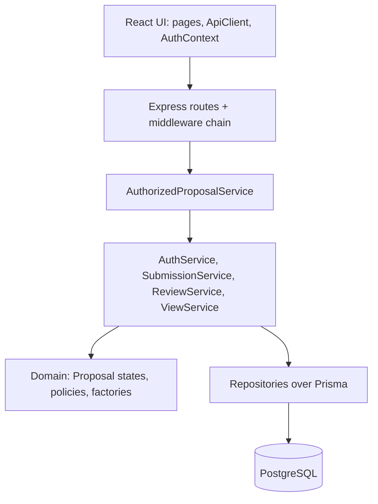
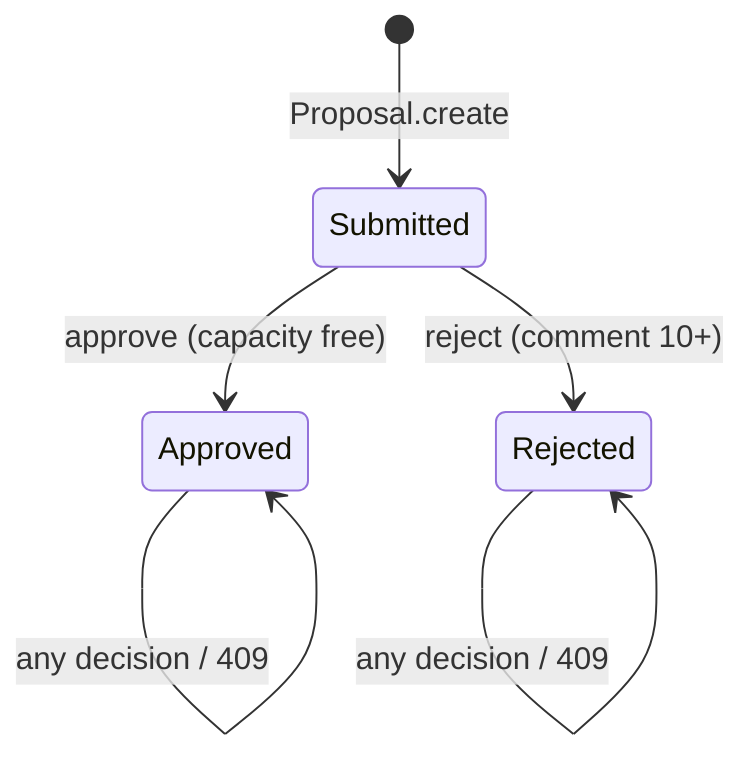

# CPMS Sprint 1 Software Architecture and Design Patterns

**Version:** 0.2 (draft for review)
**Related:** [System SDS](../../system-sds.md) · [Sprint 1 plan](plan.md) · feature contracts `F-01` to `F-06`

Design only. No code exists. A pattern is used only where it removes a real problem in this codebase (TypeScript, Express, Prisma, React). Patterns that would add classes without a Sprint 1 benefit are listed in section 5 as deliberately skipped.

## 1. Patterns used

| Pattern | Where | Why it helps |
|---|---|---|
| State | F-04 (and F-03 initial state) | The proposal lifecycle lives in state objects, so BR-04 (one decision only) is structure, not scattered `if` checks. Sprint 2 can add states or transitions in one place. |
| Facade | F-01, F-03, F-04, F-05 | One service per feature hides repositories, hashing, transactions and validation. Routes stay thin and tests target the service. |
| Proxy (protection) | F-02, UI client | A wrapper around the proposal service checks role and ownership before delegating, so a handler cannot skip authorization. The UI `ApiClient` is the single gateway to the API. |
| Chain of Responsibility | F-01, F-02 | Express middleware order `requireAuth`, `requireRole`, validation matches the SRS precedence (401, 403, 400, 409). |
| Strategy | F-02, F-05 | `StudentScope` and `SupervisorScope` supply the query filter for BR-05. A future Admin scope (F-09) is one new class. |
| Factory | F-01, F-02, F-03, F-06 | Central creation of sessions and cookie options, safe `AppError`s, `Proposal.create` (initial `SUBMITTED` state), and `createApp(deps)` for the server and for tests. |
| Test data builder | F-03 to F-06 tests and seed | `ProposalBuilder` and `UserBuilder` make scenarios like "supervisor at capacity" one readable line. Test and seed code only. |

## 2. Layers and dependency rule



Dependencies point down only. Routes never touch Prisma. Domain code imports neither Express nor Prisma, so rules unit-test without a database. Services receive repositories through constructor parameters (plain dependency injection). Config, the Prisma client and the logger are created once in module scope and passed in; tests supply their own.

## 3. Per-feature architecture

### F-06 Foundation and seed

- **Factory:** `createApp(deps)` builds the Express app for `server.ts` and for Supertest with the test DB.
- **Test data builder:** `UserBuilder`, `ProposalBuilder` (`.withStatus()`, `.forStudent()`, `.assignedTo()`, `.build()`) shared by seed and tests.
- Config is validated once with Zod at startup. Seed uses upserts, so idempotency does not depend on any pattern.

### F-01 Authentication and current user

- **Facade:** `AuthService.login`, `logout`, `me` hide bcrypt compare, session creation, expiry and cookie details.
- **Factory:** `SessionFactory.create(userId, ttlHours)` returns an opaque ID and `expiresAt`; `cookieOptionsFor(env)` sets `httpOnly`, `SameSite=Lax`, and `Secure` in production.
- **Chain of Responsibility:** `requireAuth` loads the session and attaches `{userId, role}`; a missing or expired session ends the chain with 401.
- **Proxy (UI):** `ApiClient` sends credentials and turns a 401 into a logged-out state.

### F-02 Role and ownership enforcement

- **Proxy:** `AuthorizedProposalService` implements the same interface as `ProposalService`, checks role and ownership or assignment, then delegates. Handlers hold only the proxy.
- **Chain of Responsibility:** `requireAuth`, then `requireRole(...)`, then the proxy's ownership check.
- **Factory:** `AppError.unauthenticated() / forbidden() / notFound() / conflict(code) / validation(issues)`. One error handler maps them to the JSON envelope and hides stack and SQL (NFR-03).
- **Strategy:** `scopeFor(principal)` returns the scope used by F-05 lists and detail checks.

### F-03 Submit proposal

- **Factory:** `Proposal.create({title, description, studentId, supervisorId})` sets `status = SUBMITTED` and `submittedAt`; no other layer chooses initial state.
- **Facade:** `SubmissionService.submit(principal, input)` runs Zod-validated input, supervisor check, active-proposal check and insert in one transaction.
- BR-01 is enforced by that transaction plus the partial unique index.

### F-04 Review proposal

- **State:** `ProposalState` has `approve(ctx)` and `reject(ctx)`. `SubmittedState` runs the rule checks and performs the transition. `ApprovedState` and `RejectedState` throw `AppError.conflict('ALREADY_DECIDED')`.



- **Facade:** `ReviewService.review(principal, id, decision, comment)` opens the transaction, locks proposal and supervisor rows, applies `CapacityPolicy` (BR-02) and `RejectionCommentPolicy` (BR-03) through the state object, commits, and returns the updated proposal.
- BR-02 correctness comes from the row lock, not the pattern.

### F-05 Scoped views and workload

- **Facade:** `ViewService` offers `listFor(principal)`, `detailFor(principal, id)`, `supervisorsWithCapacity()`, `workloadFor(supervisorId)`.
- **Strategy:** the scope from F-02 builds the Prisma `where`, so every list is filtered in the database (BR-05).
- **Proxy:** reads also pass through `AuthorizedProposalService`.

### UI

`AuthContext` holds the current user; pages read it through hooks. All calls go through `ApiClient`. No extra pattern layer.

## 4. Suggested file layout

```text
server/src/
  config.ts  db.ts  app.ts  errors.ts
  domain/    proposal.ts  state/{submitted,approved,rejected}.ts  policies/{capacity,rejectionComment}.ts
  services/  authService.ts  submissionService.ts  reviewService.ts  viewService.ts
  security/  requireAuth.ts  requireRole.ts  authorizedProposalService.ts  scope.ts
  repos/     userRepo.ts  sessionRepo.ts  proposalRepo.ts
  routes/
server/tests/builders/
client/src/  api/ApiClient.ts  auth/AuthContext.tsx  pages/  components/
```

## 5. Deliberately skipped

| Pattern | Reason |
|---|---|
| Singleton | Node modules already load once. Plain module-scope instances plus constructor injection give the same result and stay replaceable in tests. |
| Prototype | Seed and test objects are built with builders and spread overrides; cloning adds nothing. |
| Iterator | Sprint 1 lists are small. Revisit for Sprint 3 search and paging. |
| Observer | Only an audit log would subscribe in Sprint 1. Add an event bus when notifications or milestones (Sprint 2 or 3) need it. |
| Mediator | `ReviewService` already coordinates the few collaborators in F-04; a separate coordinator would be indirection. |

None of this changes requirements, acceptance criteria or tests. Pattern names appear in PR descriptions, not in the STS.

## Version history

| Version | Date | Change |
|---|---|---|
| 0.1 | 2026-11-06 | Initial plan covering all ten requested patterns. |
| 0.2 | 2026-11-06 | Trimmed to seven patterns that earn their place; added Chain of Responsibility and Strategy; listed skipped patterns with reasons. |
