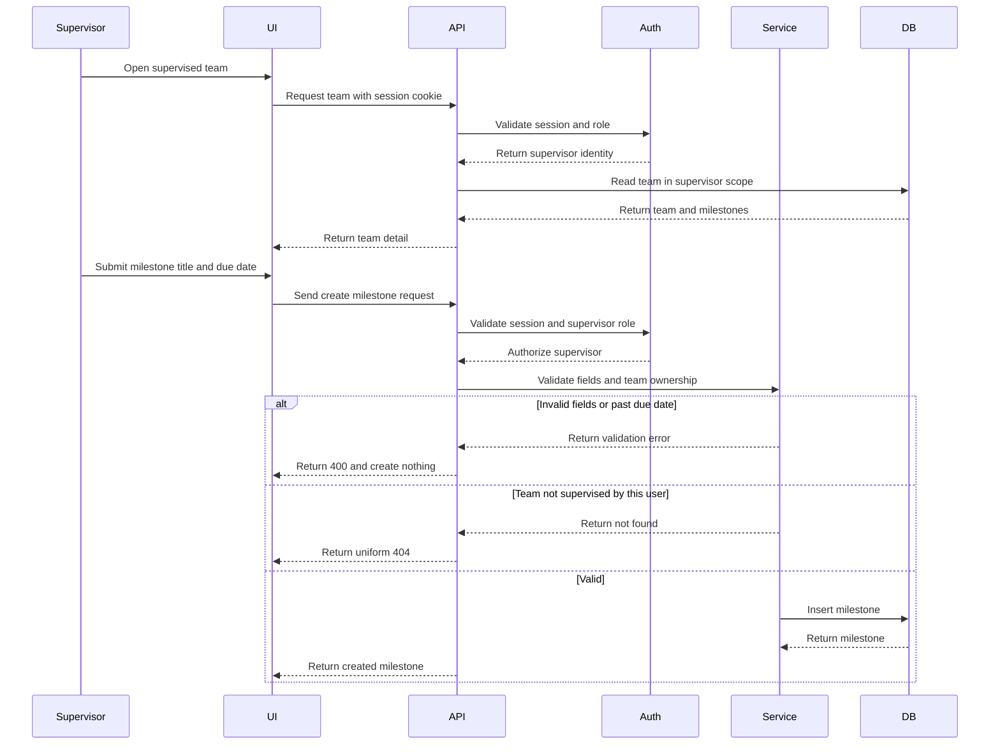
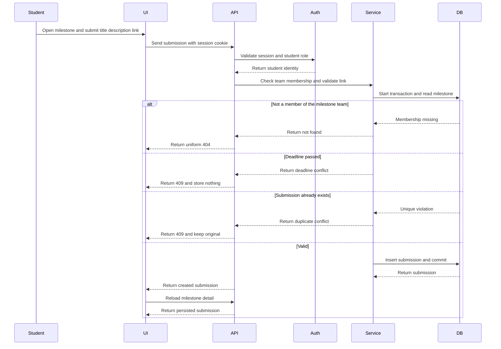
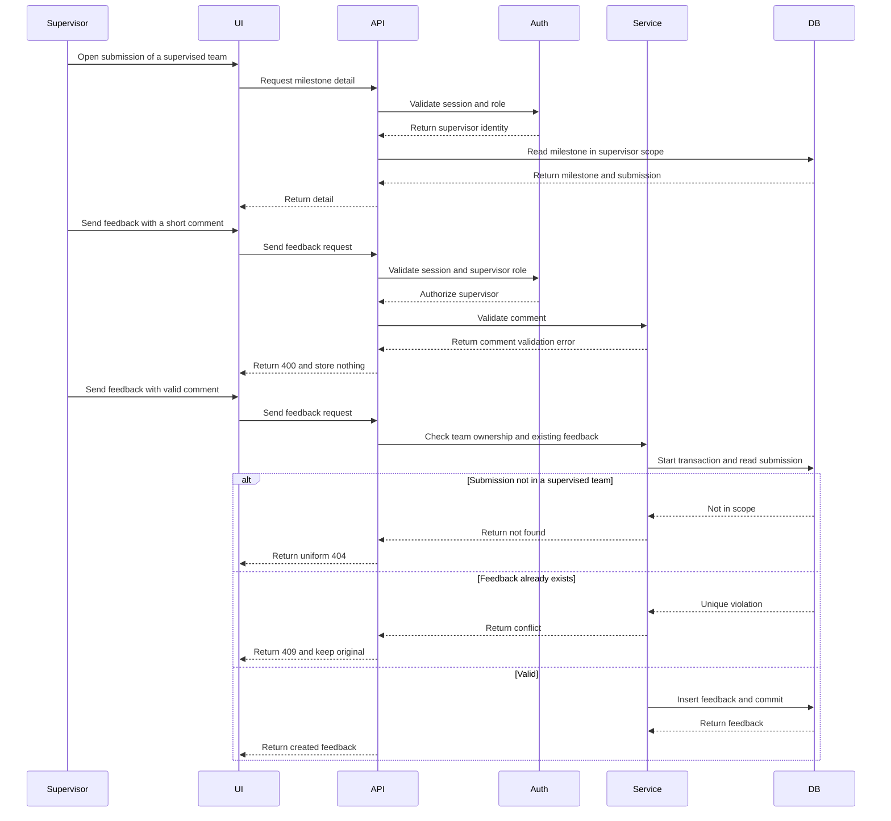
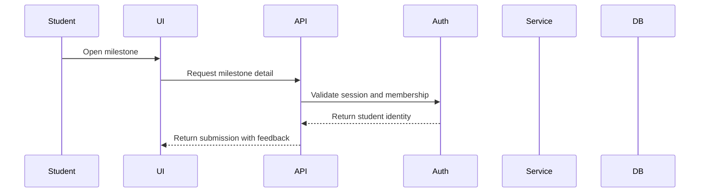

# CPMS Sprint 1 Plan: Milestone Submission and Feedback

**Version:** 2.1 (Sprint 1 approved)
**Product:** CPE 334 Course Project Management System (CPMS), Theme 6
**Developers:** Jinnakan 1010 and Drarun 1016
**Three-sprint plan:** [Sprint plan](../plan.md) · **Contracts:** F-01 to F-07 in this folder · **Tests and DoD:** [sts.md](sts.md) · **Patterns:** [architecture.md](architecture.md)

## Version history

| Version | Date | Change |
|---|---|---|
| 2.2 | 2026-11-07 | Sequence diagrams split into four, one per journey, for readability; no behavior change. |
| 2.1 | 2026-11-06 | Sprint 1 plan approved. Clarified F-01 login validation, throttling limits and test expectations. |
| 2.0 | 2026-11-06 | Reworked for Theme 6 (teams, milestones, submissions, feedback). New sequence diagrams and ownership. |
| 1.x | 2026-11-05 to 2026-11-06 | Proposal-domain drafts, superseded. |

## Sprint goal

A Supervisor logs in, opens a team they supervise and creates a milestone with a due date. A member of that team logs in, sees the milestone, submits a title, description and link, reloads and sees the saved submission. A late or second submission is rejected. The Supervisor records feedback; an invalid comment is rejected first. The team sees the feedback. A student from another team, and a supervisor of another team, see none of it.

## Scope

| Feature | Included behavior | Depends on |
|---|---|---|
| F-06 Foundation and seed | Schema, additive migration, env handling, test DB, health and ready, idempotent seed of teams, members, milestones, submissions. | none |
| F-01 Authentication | Login UI, bcrypt, expiring session, logout, `me`, enumeration and throttling defenses. | F-06 |
| F-02 Role and team ownership | Session identity, role guards, team scope, uniform 404, shared security middleware. | F-01 |
| F-07 Scoped views and progress | Team list and detail, milestone detail, computed status, shared UI states. | F-01, F-02 |
| F-03 Create milestone | Supervisor form and API with validation and future due date. | F-01, F-02, F-07 |
| F-04 Submit work | Member form and API, deadline and one-per-milestone rules, link validation. | F-03 |
| F-05 Feedback | Supervisor feedback form and API, immutable, one per submission. | F-04 |

Out of scope: registration, recovery, grades, revisions, milestone editing, uploads, notifications, admin UI, Docker, CI/CD, GCP.

## Dependency-driven work order

1. **Foundation:** Prisma entities and constraints, migration, env example, test DB, seed, health and ready.
2. **Authentication and Login UI:** login form and states, login, logout, `me`, session expiry, throttling.
3. **Authorization:** protect routes, derive identity from the session, role guards, team scope, uniform 404, shared security middleware.
4. **Read paths:** team list and detail, milestone detail, computed status, dashboards.
5. **Milestone creation:** form, validation, supervised-team check, persistence.
6. **Submission:** form, link and field validation, membership check, deadline and duplicate rules, retrieval.
7. **Feedback:** form, comment validation, supervised-team check, one-per-submission rule, visibility.
8. **Integration and acceptance:** two E2E journeys, security suite, timing and contrast evidence, release evidence.

If the order changes, record why and confirm coverage is unchanged. For each business rule keep the failing test output before implementation and the passing output after.

## Developer ownership and peer review

| Work package | Owner | Peer reviewer | Main deliverables |
|---|---|---|---|
| F-06 foundation, schema, seed, test harness | Jinnakan 1010 | Drarun 1016 | Prisma model, migration, seed idempotency, env, health, test plumbing. |
| F-01 authentication and Login UI | Drarun 1016 | Jinnakan 1010 | Login screen, auth endpoints, sessions, bcrypt, enumeration and throttle tests. |
| F-02 role and team ownership | Jinnakan 1010 | Drarun 1016 | Middleware, team scope, uniform 404, shared security checks and tests. |
| F-07 scoped views and progress | Jinnakan 1010 | Drarun 1016 | Team and milestone queries, computed status, dashboards and UI states. |
| F-03 create milestone | Drarun 1016 | Jinnakan 1010 | Milestone form and API, validation, supervisor scope. |
| F-04 submit work | Jinnakan 1010 | Drarun 1016 | Submission form and API, deadline and duplicate rules, link validation. |
| F-05 feedback | Drarun 1016 | Jinnakan 1010 | Feedback form and API, one-per-submission, visibility. |
| Integration and release evidence | Both | Each reviews the other | E2E journeys, security suite, screenshots, evidence, contribution table. |

Both developers understand the full design. Neither approves their own PR. Apply the Issue, Kanban, staging-branch, review and release rules in [AGENTS.md](../../../AGENTS.md).

## Sequence diagrams

Lifelines are the swimlanes across actor, browser UI, API, auth middleware, application service and database. Each journey is drawn as its own diagram so the text stays readable.

| Diagram | Owner | Reviewer | Required branches |
|---|---|---|---|
| Supervisor creates milestone; member submits | Drarun 1016 | Jinnakan 1010 | Invalid milestone; unsupervised team; deadline passed; duplicate; success and readback. |
| Supervisor records feedback | Jinnakan 1010 | Drarun 1016 | Invalid comment; unassigned supervisor; feedback exists; success; member reads feedback. |

### Supervisor creates a milestone

### A team member submits work

### Supervisor records feedback

### The team reads the feedback

## Issue, branch, test and review flow

Follow [AGENTS.md](../../../AGENTS.md). Each feature has an Issue linked to its feature ID, FR, BR, NFR, contract, ACs and tests. Record actual verification results; report failures and skips; keep failing-before and passing-after evidence. Never weaken a test to get a pass.

## Verification outcomes

The implementation must verify:

- Valid and invalid login, logout, current user, expired and revoked sessions.
- 401 on every protected endpoint; 403 for wrong role; uniform 404 for another team's data.
- Milestone, submission and feedback field boundaries; link scheme validation.
- BR-01 duplicate submission (including concurrent), BR-02 deadline (before, at and after `dueAt`), BR-05 one feedback and comment length, BR-06 team scope.
- Persisted milestone to submission to feedback journeys through UI, API and database.
- The security suite (SEC-01 to SEC-20), seed idempotency, hashed passwords, safe errors.
- Accessible UI states, contrast calculation and representative local timing.
- Actual build and test commands, counts and results at a specific release commit.

## Definition of Sprint 1 completion

See the Product Definition of Done in [sts.md](sts.md). In short: F-01 to F-07 behave as contracted with recorded results; both journeys work through UI, API and database; every AC maps to a test and failures are disclosed; features are peer reviewed into staging and released to `main` with a tag; setup docs and Part F evidence are ready; no real secrets anywhere.

## Current status

F-01 to F-07 are implemented and merged into `sprint-1-staging`. The release to `main`, its tag and the observed test results are recorded in the submission PDF (Part F) and in `evidence/`.
