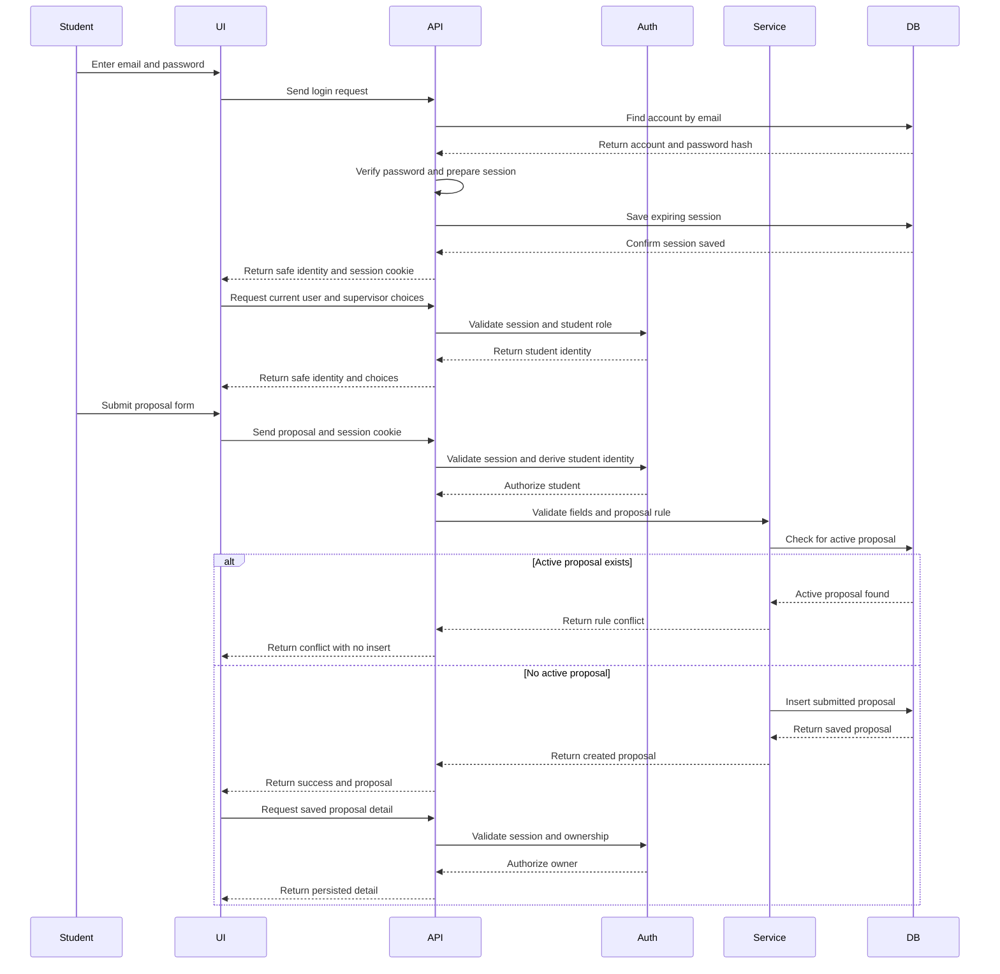
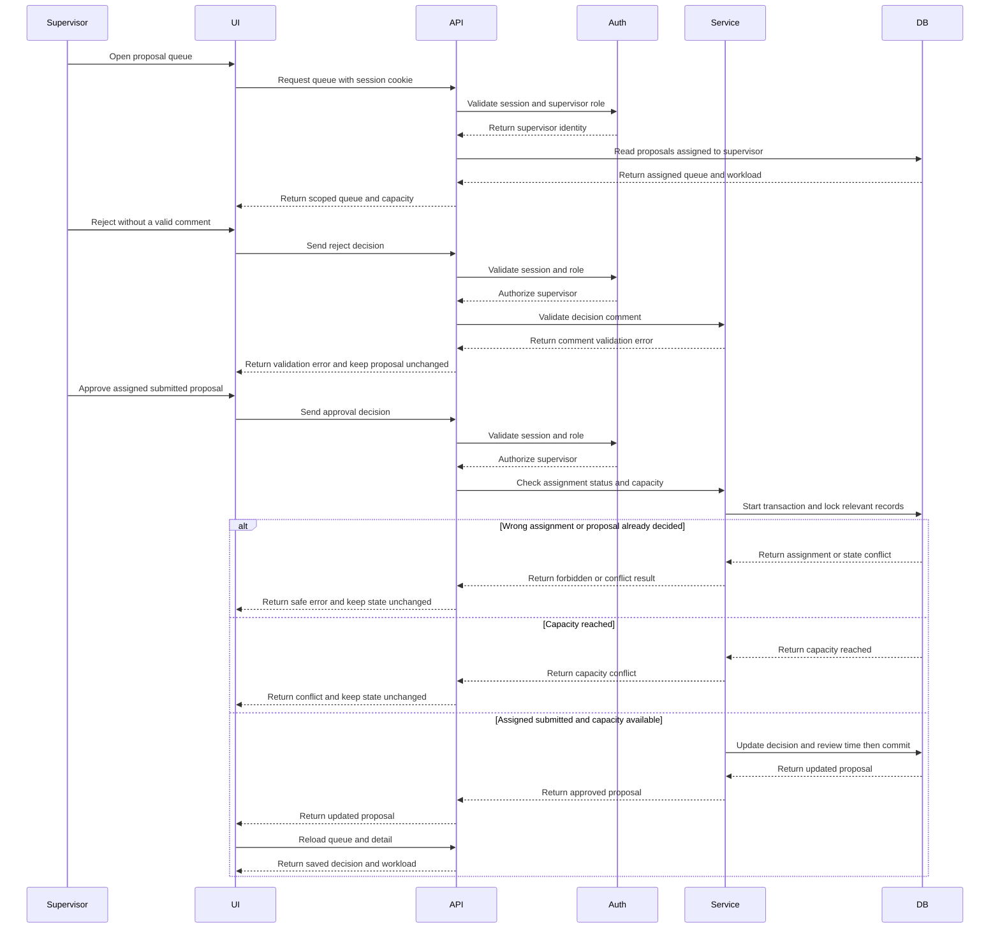

# CPMS Sprint 1 Plan — Secure Proposal Lifecycle

**Status:** Draft for review  
**Product:** CPE 334 Course Project Management System (CPMS)  
**Developers:** Jinnakan 1010 and Drarun 1016  
**Three-sprint plan:** [Sprint plan](../plan.md)  
**Contracts:** F-01 to F-06 in this folder · **Tests and DoD:** [sts.md](sts.md)  
**Planning boundary:** Sprint 1 only. No calendar schedule or effort estimates.

## Version history

| Version | Date | Change |
|---|---|---|
| 0.1 | 2026-11-05 | Initial three-sprint roadmap and Sprint 1 delivery outline. |
| 0.2 | 2026-11-05 | Added owner/reviewer assignments, dependency-based work packages, verification plan, and UML sequence swimlane work. |
| 0.3 | 2026-11-05 | Separated product-level Sprints 1–3 roadmap into `docs/plans/project-plan.md`; narrowed this document to Sprint 1. |
| 0.4 | 2026-11-06 | Aligned Sprint 1 documents under `docs/sprints/sprint-1/` and moved all architecture, data-model, and sequence diagrams into this plan. |
| 0.5 | 2026-11-06 | Clarified Sprint 1 branch names, issue flow, and pull-request targets to match the per-sprint staging rule. |
| 0.6 | 2026-11-06 | Specification split into per-feature contracts and `sts.md`; architecture and data-model diagrams moved to `docs/system-sds.md`; sequence diagrams kept here. |

## Sprint goal

Deliver a working proposal lifecycle with a Login screen and related authentication code, role-specific UI, Express API enforcement, and PostgreSQL persistence. A Student logs in, submits a proposal, reloads, and sees the saved result. The assigned Supervisor logs in, sees assigned workload and queue, receives a validation error when attempting to reject without a valid comment, then makes a valid decision and sees the saved result. Unauthorized and cross-user operations expose no private data.

## Sprint scope

| Feature | Included behavior | Depends on |
|---|---|---|
| F-06 Foundation and synthetic data | Schema, additive migration, env handling, separate test DB setup, health/ready endpoints, idempotent synthetic seed. | None |
| F-01 Authentication/current user | Login UI, valid/invalid credential behavior, bcrypt verification, database-backed expiring session, logout, current-user lookup. | F-06 |
| F-02 Role and ownership | Session-derived identity, Student/Supervisor role checks, record ownership and assignment checks, safe errors. | F-01 |
| F-05 Scoped views | Supervisor choices, Student own list/detail/history, Supervisor assigned queue/detail/workload, shared UI states. | F-01, F-02, proposal schema |
| F-03 Proposal submission | Student selects a supervisor and submits bounded title/description; enforce BR-01; persist/read back. | F-01, F-02, F-05 supervisor choices |
| F-04 Proposal review | Assigned Supervisor approves/rejects submitted proposal; enforce BR-02–BR-04; persist decision and timestamp. | F-01, F-02, F-03, F-05 queue |
| Integrated UI and verification | Student/Supervisor dashboards, detail and review panel, two critical E2E journeys, API/DB checks, release evidence. | F-01–F-06 |

No Sprint 2 or Sprint 3 planning is included in this sprint plan. Out of scope: self-registration, password recovery, admin UI, file uploads, notifications, milestones, grading, Docker/CI/CD completion, and deployment.

## Dependency-driven work order

1. **Foundation:** define Prisma entities/constraints, additive migration, local env example, test database, synthetic seed, and health/readiness endpoints.
2. **Authentication and Login UI:** build login form and its pending/error/success states; implement login/logout/me and session expiry; verify password hashes and cookie behavior.
3. **Authorization:** protect routes, derive identity and role from session, enforce role and ownership/assignment boundaries.
4. **Read paths:** implement student/supervisor-scoped lists and detail, safe supervisor picker, remaining capacity, and workload queries.
5. **Submission:** implement form validation, server-side Student identity, supervisor selection, active-proposal check, transaction/persistence, and retrieval.
6. **Review:** implement assignment and state checks, reject-comment validation, approval capacity check, atomic transition, review comment/timestamp persistence.
7. **Integrated UI and acceptance:** complete dashboards, detail, review panel, loading/empty/error/success states, accessibility and contrast evidence, E2E journeys, integration checks, and release evidence.

If implementation order changes, record why and ensure requirements, contracts, and tests still cover the same behavior. For each business rule, retain the intended failing test output before implementation and passing output afterward.

## Developer ownership and peer review

| Work package | Owner | Peer reviewer | Main deliverables |
|---|---|---|---|
| F-06 foundation, schema, seed, test harness | Jinnakan 1010 | Drarun 1016 | Prisma model/migration, seed safety/idempotency, env setup, health/ready and test plumbing. |
| F-01 authentication and Login UI | Drarun 1016 | Jinnakan 1010 | Login screen, auth endpoints, session lifecycle, bcrypt and cookie tests. |
| F-02 role and ownership enforcement | Jinnakan 1010 | Drarun 1016 | Reusable backend checks and API coverage for role, owner, and supervisor assignment. |
| F-05 scoped views and supervisor directory | Drarun 1016 | Jinnakan 1010 | Role-scoped queries, workload data, safe picker response, dashboards and UI states. |
| F-03 Student proposal submission | Drarun 1016 | Jinnakan 1010 | Submission form/API, validation, BR-01 enforcement, persistence and retrieval. |
| F-04 Supervisor review | Jinnakan 1010 | Drarun 1016 | Review API/panel, BR-02–BR-04 enforcement and transactional state update. |
| Integration and release evidence | Both | Each reviews the other's changes | E2E journeys, integration/system checks, screenshot selection, evidence and contribution record. |

Both developers review the full design and understand the released behavior. Neither developer approves their own PR. Apply the repository-wide Issue, Kanban, staging-branch, review, and release rules in [AGENTS.md](../../../AGENTS.md); this sprint uses the Sprint 1 staging branch and the feature assignments above.

## Design diagrams

The sequence diagrams cover both primary role journeys. Sequence lifelines are the swimlanes across actor, browser UI, API/auth middleware, application service, and database.

Architecture and data-model diagrams are in the [system SDS](../../system-sds.md).

| Diagram | Owner | Reviewer | Required branches |
|---|---|---|---|
| Student login and proposal submission | Drarun 1016 | Jinnakan 1010 | Session created; invalid login; valid supervisor selection; BR-01 conflict; successful persistence and readback. |
| Supervisor review and capacity decision | Jinnakan 1010 | Drarun 1016 | Invalid reject comment; wrong assignment; already decided; full capacity; valid decision and readback. |

#### Student login and proposal submission

#### Supervisor review and capacity decision

## Issue, branch, test, and review flow

For each feature, follow the root [AGENTS.md](../../../AGENTS.md) workflow. Sprint-specific execution order, owner/reviewer, AC mapping, and test-first expectations are listed in this plan and the linked contracts and STS. Record actual verification results; report failures/skips and preserve failing-before/passing-after evidence. Never weaken tests to manufacture a pass.

## Verification outcomes

The STS and DoD are in; ACs are in the feature contracts, and [sts.md](sts.md). The implementation phase must verify:

- Valid and invalid login; logout; current user; expired/revoked session behavior.
- 401 for unauthenticated protected endpoints; forbidden role actions; cross-user and unassigned-supervisor access with no private data.
- Proposal field boundaries, BR-01 active-proposal rejection/resubmission after rejection, BR-02 capacity rejection, BR-03 comment validation, and BR-04 assigned-only single decision.
- Persisted student submit-and-reload journey and supervisor invalid-reject-then-valid-decision journey.
- DB integration on a separate test database; synthetic seed; NFR-02 password hashing; NFR-03 safe errors.
- Accessible UI states, keyboard behavior, palette contrast calculation, and representative local response timings.
- Actual build/test commands and outputs, test names/counts/results at a specific release commit.

## Definition of Sprint 1 completion

- F-01–F-06 behavior is implemented to the approved contracts; actual test runs and results are recorded.
- Login UI and complete Student/Supervisor proposal journeys work through UI, API, and database.
- Each AC maps to verification; all failures/skips are disclosed; no claimed results lack command output.
- Peer-reviewed feature changes are integrated through staging and a reviewed release change; both developers' meaningful contributions are recorded.
- README/setup documentation, migration/seed instructions, selected screenshots, test excerpts, known limitations, and the self-contained Part F evidence are ready.
- No real secrets appear in code, Git, logs, or screenshots.

## Current status

This document is a plan only. Implementation, test execution, GitHub Issues/PRs, screenshots, and release evidence have not been produced here. Work remains paused until the user approves the Sprint 1 documentation.
