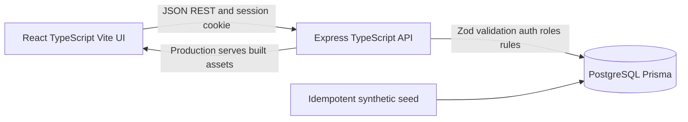
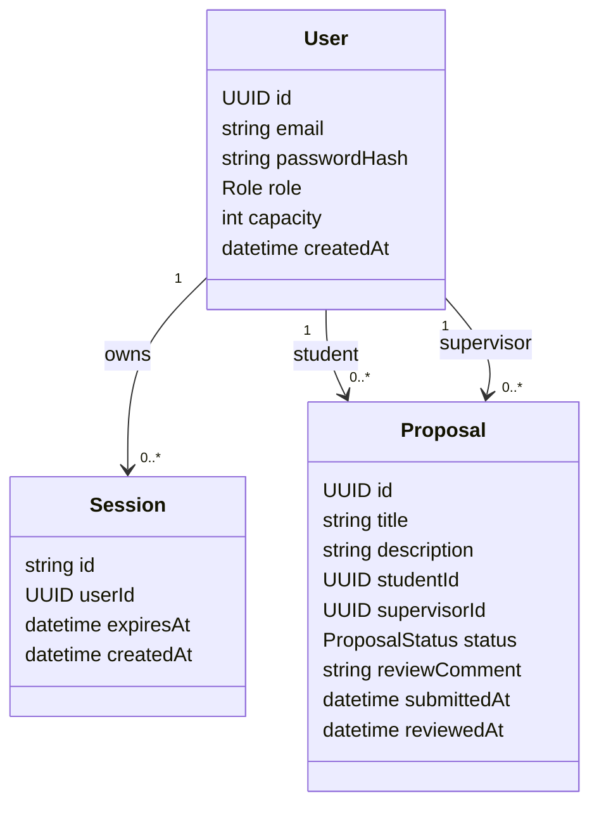

# CPMS System-Level Software Design Specification (Part C)

**Version:** 1.0 (draft for review)
**Related:** [SRS](srs.md) · [Sprint 1 plan](sprints/sprint-1/plan.md) (sequence diagrams) · [AGENTS.md](../AGENTS.md)

## 1. Architecture and stack

| Layer | Choice | Responsibility |
|---|---|---|
| UI | React, TypeScript, Vite, React Router, CSS variables | Accessible forms, navigation, client feedback, role-appropriate presentation. Not a security boundary. |
| API and application | Node, Express, TypeScript, Zod | Validate input, authenticate the session, derive user and role, authorize, apply business rules transactionally, return safe JSON. |
| Database | PostgreSQL with Prisma | Persist users, sessions and proposals; additive migrations; constraints. |
| Tests | Vitest, Supertest, Playwright | Unit, API and DB integration on a separate test DB, one or two E2E journeys. |

The UI talks to the API over JSON REST with a session cookie. Every business rule (BR-01 to BR-06) is enforced in the application layer and, where concurrency matters, backed by a database transaction or constraint. In production Express serves the built client assets.

## 2. Data model

| Entity | Fields and constraints |
|---|---|
| `User` | `id` UUID; `email` unique, lowercased; `passwordHash` bcrypt only; `role` is `STUDENT` or `SUPERVISOR`; `capacity` default 5, meaningful only for supervisors. |
| `Session` | Opaque random `id`; FK to `User`; `expiresAt`; `createdAt`. Deleted or marked revoked on logout. The cookie holds only this ID. |
| `Proposal` | `id`; `title` 5 to 100 chars; `description` 20 to 2000 chars; FK `studentId` to a Student; FK `supervisorId` to a Supervisor; `status` is `SUBMITTED`, `APPROVED` or `REJECTED`; nullable `reviewComment`; `submittedAt`; nullable `reviewedAt`. |

Lifecycle: a proposal is created `SUBMITTED` and moves once to `APPROVED` or `REJECTED`. No edit, delete or re-review exists.

Concurrency: BR-01 is backed by a partial unique index on `studentId` where status is `SUBMITTED` or `APPROVED`. BR-02 is enforced by locking the supervisor row inside the review transaction before counting approvals.

Database setup: Prisma migrations are additive. A separate test database is configured through its own `DATABASE_URL`. Seed data is synthetic and idempotent (3 Students, 2 Supervisors, proposals in several states).

## 3. UI conventions

Screens: Login; Student dashboard (current status, submit form, history); Proposal detail; Supervisor dashboard (capacity and approved count, pending queue, decided list); review panel.

Shared behavior: every data view has loading, empty, error and success states. Fields are labeled with inline validation. Focus is visible and everything is keyboard reachable. Actions the role cannot perform are hidden, but the API remains authoritative.

Theme tokens: background `#F8FAFC`, surface white, text `#0F172A`, muted `#475569`, border `#E2E8F0`, panel `#F1F5F9`, accent `#4F46E5` (hover `#4338CA`), status `#15803D` / `#B45309` / `#B91C1C` always paired with a text label. Inter or system-ui, 16px base, line-height 1.5. Dashboard cards use a 12-column grid with 16 to 24px gaps.

## 4. API conventions

- JSON in and out. Zod validates every request body, params and query.
- Success is 200 or 201. Errors use `{ "error": { "code": "...", "message": "..." } }`.
- Status codes: 400 validation, 401 unauthenticated, 403 forbidden, 404 missing or privacy-safe, 409 rule conflict.
- Responses never include password hashes, session tokens, stack traces, SQL or inaccessible proposal data.
- Unexpected errors return a generic 500 body and are logged server-side only.

| Method and path | Access | Purpose |
|---|---|---|
| `GET /api/health` | Public | Liveness, no DB. |
| `GET /api/ready` | Public | Readiness, checks DB. |
| `POST /api/auth/login` | Public | `{email,password}`; sets session cookie. |
| `POST /api/auth/logout` | Authenticated | Revokes session, clears cookie. |
| `GET /api/auth/me` | Authenticated | Safe `id`, `email`, `role`. |
| `GET /api/supervisors` | Student | Safe names and `remainingCapacity`. |
| `POST /api/proposals` | Student | `{title,description,supervisorId}`. |
| `GET /api/proposals` | Authenticated | Own (Student) or assigned (Supervisor) list, plus workload for Supervisors. |
| `GET /api/proposals/:id` | Owner or assigned Supervisor | Detail. |
| `POST /api/proposals/:id/review` | Assigned Supervisor | `{decision,comment?}`. |

Request and response shapes per endpoint are in the [Sprint 1 feature contracts](sprints/sprint-1/).

## 5. Role and ownership matrix

| Operation | Anonymous | Student | Assigned Supervisor | Other Supervisor |
|---|---|---|---|---|
| Login | Allow | Allow | Allow | Allow |
| Logout, `me` | 401 | Own session | Own session | Own session |
| List supervisors | 401 | Allow | 403 | 403 |
| Submit proposal | 401 | Allow (ID from session) | 403 | 403 |
| List proposals | 401 | Own only | Assigned only | Assigned only |
| Read proposal detail | 401 | Own only | Assigned only | 403 or privacy-safe 404 |
| Review proposal | 401 | 403 | Allow while `SUBMITTED` | 403 or privacy-safe 404 |
| Read workload | 401 | 403 | Own only | Own only |

A Student reading another Student's proposal gets 403 or privacy-safe 404. No client-supplied user ID or role is ever trusted.

## 6. Authentication design

- Passwords hashed with bcrypt; the plaintext is never stored or logged.
- Login looks up the user by email and compares the hash. Any failure returns the same generic 401.
- On success the server creates a `Session` row with `expiresAt = now + SESSION_TTL_HOURS` and sets a cookie holding the session ID: `httpOnly`, `SameSite=Lax`, `Secure` when `NODE_ENV=production`.
- Auth middleware loads the session on every protected request, rejects missing, expired or revoked sessions with 401, and attaches the user's ID and role to the request. Handlers read identity only from there.
- `me` returns the safe identity. Logout deletes or revokes the session and clears the cookie.

## 7. Configuration and secrets

| Variable | Purpose | Secret |
|---|---|---|
| `DATABASE_URL` | PostgreSQL connection (separate value for tests) | Yes |
| `PORT` | Express port | No |
| `SESSION_SECRET` | Session crypto secret if the chosen implementation needs one | Yes |
| `SESSION_TTL_HOURS` | Session lifetime | No |
| `NODE_ENV` | Runtime mode; controls the `Secure` cookie | No |
| `SEED_STUDENT_PASSWORD` | Password for seeded students | Yes |
| `SEED_SUPERVISOR_PASSWORD` | Password for seeded supervisors | Yes |

All config comes from the environment. `.env.example` holds placeholders only and `.env` is git-ignored. Real secrets never appear in Git, client code, logs, screenshots or the PDF.

## 8. Deployment plan (Lab 5, not Deliverable 1)

One container with Express serving the built client. Cloud Run runs the service, Cloud SQL provides PostgreSQL, Secret Manager holds secrets, and configuration stays in environment variables. A CI/CD pipeline will build, test and deploy. `GET /api/health` and `GET /api/ready` support platform probes. The app is built to be Docker-ready, and no cloud setup is done now.
