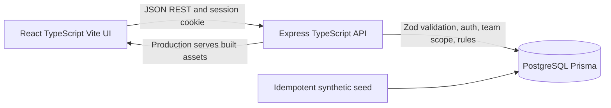
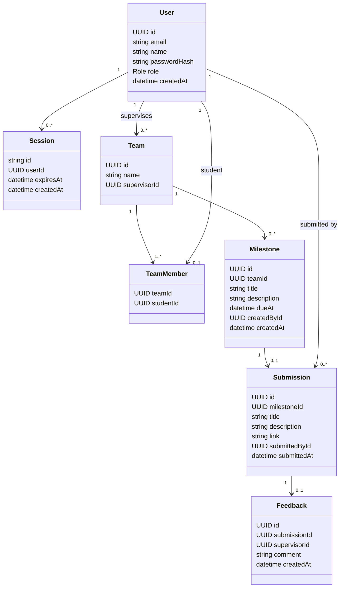

# CPMS System-Level Software Design Specification (Part C)

**Version:** 2.0 (draft for review)
**Related:** [SRS](srs.md) · [Architecture plan](architecture.md) · [Sprint 1 plan](sprints/sprint-1/plan.md) · [AGENTS.md](../AGENTS.md)

## Version history

| Version | Date | Change |
|---|---|---|
| 2.0 | 2026-11-06 | Data model, API, UI and permission matrix reworked for Theme 6. |
| 1.0 | 2026-11-06 | Initial (proposal domain, superseded). |

## 1. Architecture and stack

| Layer | Choice | Responsibility |
|---|---|---|
| UI | React, TypeScript, Vite, React Router, CSS variables | Accessible forms, navigation, client feedback. Not a security boundary. |
| API and application | Node, Express, TypeScript, Zod | Validate input, authenticate the session, derive user and role, authorize by team, apply rules transactionally, return safe JSON. |
| Database | PostgreSQL with Prisma | Persist users, sessions, teams, memberships, milestones, submissions, feedback; additive migrations; constraints. |
| Tests | Vitest, Supertest, Playwright | Unit, API and DB integration on a separate test DB, two E2E journeys. |

The UI talks to the API over JSON REST with a session cookie. Business rules BR-01 to BR-07 are enforced in the application layer and, where concurrency matters, backed by a database constraint or transaction. This is a modular monolith: one container in production, with Express serving the built client. It satisfies the spec's UI to API to persistent database requirement.

## 2. Data model

| Entity | Fields and constraints |
|---|---|
| `User` | `id` UUID; `email` unique, stored lowercase; `name`; `passwordHash` bcrypt only; `role` `STUDENT` or `SUPERVISOR`. |
| `Session` | Opaque random `id` (at least 128 bits); FK `userId`; `expiresAt`; `createdAt`. The cookie holds only this ID. |
| `Team` | `id`; `name` unique; FK `supervisorId` to a Supervisor. |
| `TeamMember` | Composite key `(teamId, studentId)`; `studentId` unique, so a student belongs to one team (D-05); FK to a Student. |
| `Milestone` | FK `teamId`; `title` 5 to 100; `description` 0 to 1000; `dueAt`; FK `createdById` (the team's supervisor); `createdAt`. |
| `Submission` | `milestoneId` unique (BR-01); `title` 5 to 100; `description` 20 to 2000; `link` http or https, at most 500; FK `submittedById` (a team member); `submittedAt`. Never updated or deleted in Sprint 1. |
| `Feedback` | `submissionId` unique (BR-05); FK `supervisorId`; `comment` 10 to 2000 trimmed; `createdAt`. Never updated or deleted in Sprint 1. |

Milestone status is computed, not stored: `REVIEWED` if feedback exists, else `SUBMITTED` if a submission exists, else `OVERDUE` if `dueAt` has passed, else `NOT_SUBMITTED`.

Concurrency: BR-01 is the unique index on `Submission.milestoneId`; a concurrent second insert fails and maps to 409. BR-05 is the unique index on `Feedback.submissionId`.

Time: the application reads time from an injectable clock so deadline tests are deterministic.

Database setup: Prisma migrations are additive; a separate test database has its own `DATABASE_URL`; the seed is synthetic and idempotent (see F-06).

## 3. UI conventions

Screens: Login; Student home (team, members, supervisor, milestone list with status); Milestone detail (description, due date, submission, feedback, submit form); Supervisor home (assigned teams with milestone progress); Team detail (milestones, create milestone form); Submission detail with feedback form.

Shared behavior: loading, empty, error and success states on every data view. Labeled fields with inline validation. Visible focus and keyboard access. Dates shown with the due time and an overdue badge. Actions the role cannot use are hidden, but the API stays authoritative. The submission link is rendered as text with an `rel="noopener noreferrer"` anchor only for http and https values.

Theme tokens: background `#F8FAFC`, surface white, text `#0F172A`, muted `#475569`, border `#E2E8F0`, panel `#F1F5F9`, accent `#4F46E5` (hover `#4338CA`), status `#15803D` / `#B45309` / `#B91C1C` always paired with a text label. Inter or system-ui, 16px base, line-height 1.5, 12-column card grid.

## 4. API conventions

- JSON in and out. Zod validates body, params and query; unknown fields are rejected.
- Success 200 or 201. Errors use `{ "error": { "code": "...", "message": "..." } }`.
- Status codes: 400 validation, 401 unauthenticated, 403 wrong role, 404 not found or not yours (uniform), 409 rule conflict, 415 non-JSON body, 429 throttled.
- Responses never include password hashes, session tokens, other teams' data, stack traces or SQL.

| Method and path | Access | Purpose |
|---|---|---|
| `GET /api/health`, `GET /api/ready` | Public | Liveness without DB, readiness with DB. |
| `POST /api/auth/login` | Public | `{email,password}`; sets cookie. |
| `POST /api/auth/logout` | Authenticated | Revoke session. |
| `GET /api/auth/me` | Authenticated | `{id,email,name,role}`. |
| `GET /api/teams` | Authenticated | Student: own team. Supervisor: assigned teams. Each with milestone progress summary. |
| `GET /api/teams/:teamId` | Team member or team supervisor | Team, members, supervisor, milestones with status. |
| `POST /api/teams/:teamId/milestones` | Team supervisor | `{title,description?,dueAt}`. |
| `GET /api/milestones/:milestoneId` | Team member or team supervisor | Milestone with submission and feedback. |
| `POST /api/milestones/:milestoneId/submission` | Team student | `{title,description,link}`. |
| `POST /api/submissions/:submissionId/feedback` | Team supervisor | `{comment}`. |

Request and response shapes are in the [Sprint 1 feature contracts](sprints/sprint-1/).

## 5. Role and ownership matrix

"Own team" means the user is a member (Student) or the assigned supervisor (Supervisor).

| Operation | Anonymous | Student, own team | Student, other team | Supervisor, own team | Supervisor, other team |
|---|---|---|---|---|---|
| Login | Allow | Allow | n/a | Allow | n/a |
| Logout, `me` | 401 | Own session | n/a | Own session | n/a |
| List teams | 401 | Own team | n/a | Assigned teams | n/a |
| Read team, milestone, submission, feedback | 401 | Allow | 404 | Allow | 404 |
| Create milestone | 401 | 403 | 403 | Allow | 404 |
| Submit work | 401 | Allow (before deadline, once) | 404 | 403 | 403 |
| Record feedback | 401 | 403 | 403 | Allow (once per submission) | 404 |

The role check runs before the team check, so a Student calling a Supervisor route gets 403 even for another team. For any other cross-team read or write by an allowed role, the response is the same 404 as a nonexistent ID. No client-supplied user ID, role or team is trusted as authority.

## 6. Authentication design

- Passwords hashed with bcrypt; plaintext never stored or logged.
- Login looks up the user by lowercased email and compares the hash. Unknown emails still run a dummy compare so timing matches. Any failure returns the same generic 401.
- On success the server creates a `Session` row with `expiresAt = now + SESSION_TTL_HOURS`, revokes any session the request presented, and sets a cookie with the new ID: `httpOnly`, `SameSite=Lax`, `Path=/`, `Secure` in production.
- Auth middleware loads the session on every protected request, rejects missing, expired or revoked sessions with 401, and attaches the user ID and role. Handlers read identity only from there.
- `me` returns safe identity. Logout deletes the session and clears the cookie.
- Failed logins are throttled (NFR-10).

## 7. Configuration and secrets

| Variable | Purpose | Secret |
|---|---|---|
| `DATABASE_URL` | PostgreSQL connection (separate value for tests) | Yes |
| `PORT` | Express port | No |
| `SESSION_SECRET` | Session crypto secret if needed | Yes |
| `SESSION_TTL_HOURS` | Session lifetime | No |
| `NODE_ENV` | Runtime mode; controls `Secure` cookie | No |
| `ALLOWED_ORIGIN` | Origin accepted for state-changing requests | No |
| `SEED_STUDENT_PASSWORD` | Password for seeded students | Yes |
| `SEED_SUPERVISOR_PASSWORD` | Password for seeded supervisors | Yes |

All config comes from the environment. `.env.example` holds placeholders only and `.env` is git-ignored. No real secret appears in Git, client code, logs, screenshots or the PDF.

## 8. Deployment plan (Lab 5, not Deliverable 1)

One container with Express serving the built client. Cloud Run runs it, Cloud SQL provides PostgreSQL, Secret Manager holds secrets, configuration stays in environment variables. CI runs build, tests and security checks on PRs and blocks failures, then a pipeline deploys accepted releases from `main`. Data must survive restart and redeploy, which the managed database provides. The app is built to be Docker-ready; no cloud command is run now.
